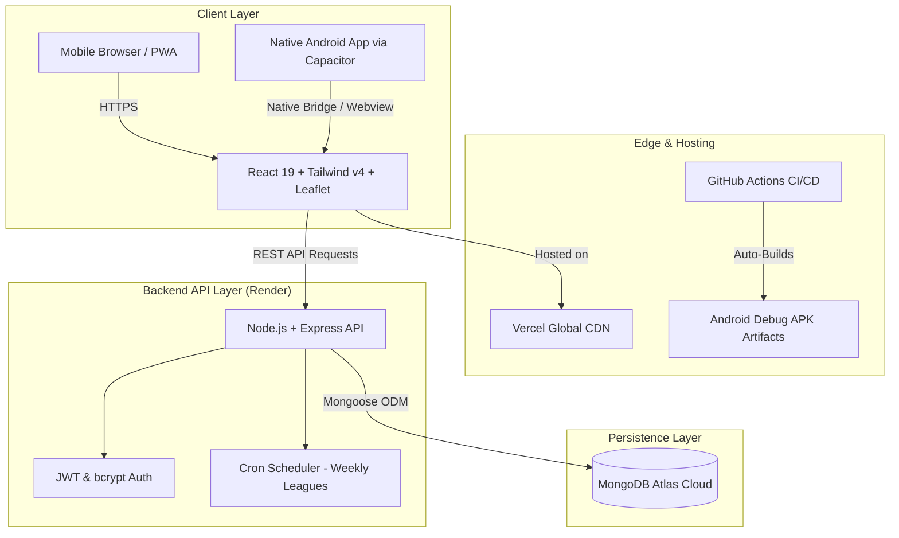

<div align="center">

# 🏃‍♂️ CONQUR
### *Run. Capture. Conquer.*

**A GPS-powered, full-stack territory conquest game that turns outdoor running into a competitive turf war.**

[](https://github.com/abhassachan/Minor_Project/actions/workflows/build-android.yml)
[](https://conqurr.vercel.app/)
[](https://territory-run-api.onrender.com)
[](https://capacitorjs.com/)
[](https://react.dev/)
[](https://tailwindcss.com/)
[](LICENSE)

<br/>

[🌐 **Launch Live Web App**](https://conqurr.vercel.app/) • [📱 **Download Android APK (Direct)**](https://conqurr.vercel.app/CONQUR.apk) • [📡 **API Health Check**](https://territory-run-api.onrender.com/)

<br/>

</div>

---

## 📖 Overview

Most fitness trackers reduce running to pace, heart rate, and solitary stats. **CONQUR** transforms the physical city into a competitive board game:

1. **Lace up and run:** Real-time hardware GPS tracks your path across streets and parks.
2. **Enclose territory:** Complete a closed route loop, and CONQUR's geospatial engine turns the enclosed polygon into your claimed territory.
3. **Fight Clan Wars:** Form running clubs, battle rival squads for neighborhood dominance, and defend your home turf.
4. **Climb the Ranks:** Earn XP, trigger automated weekly promotions through competitive leagues, and etch your name into the leaderboard.

Available as both a responsive, installable **Progressive Web App (PWA)** and a **Native Android Application** built with Capacitor.

---

## ✨ Key Features

### 🗺️ Real-Time Geospatial Territory Engine
- **Hardware GPS Tracking:** Tracks live coordinates with high-accuracy filters and dynamic distance calculation.
- **Closed-Loop Detection:** Detects when a runner has closed a circuit and computes the enclosed polygon area using geospatial ray-casting.
- **Interactive Tactical Map:** Custom Leaflet-based map with dark tactical styling, neon territory pulses, and dynamic ownership heatmaps.

### ⚔️ Clans & Clan Wars
- **Form & Join Clans:** Create private or public running clans with custom codes and shareable invite links.
- **Territory War Mode:** Toggle between global world view and exclusive Clan War view to see only member territories and battle rival crews.
- **Integrated Clan Chat:** Real-time in-app communication channel for coordinating morning runs and squad attacks.

### 🏆 Weekly Leagues & Gamification
- **Tiered Competitive Leagues:** Bronze, Silver, Gold, Platinum, Diamond, and Conqueror.
- **Automated Promotion Engine:** Background cron services rank runners weekly and automatically promote top performers while relegating inactive players.
- **Trophy Cabinet & Streaks:** Persistent achievements, daily run streak tracking, and XP progression.

### 📱 Native Android App & CI/CD Pipeline
- **Capacitor 8 Architecture:** Native Android wrapper with fine location background permissions, hardware haptics, and status-bar customization.
- **Automated GitHub Actions CI/CD:** Headless Gradle builds on every commit (`./gradlew assembleDebug` with Java 21 & Android SDK 36), publishing downloadable APK artifacts automatically.
- **Direct Website Downloads:** Built-in APK hosting directly from the landing page and profile dashboard.

---

## 🛠️ Architecture & Tech Stack



### Technologies Used

| Domain | Technologies |
|---|---|
| **Frontend** | React 19, Vite 7, Tailwind CSS v4, Leaflet, React-Leaflet, Lucide React, PWA |
| **Mobile** | Capacitor 8, Native Android (Java 21, AGP 8.13.0, Android SDK 36) |
| **Backend** | Node.js, Express.js, JWT (JSON Web Tokens), bcryptjs, node-cron |
| **Database** | MongoDB Atlas, Mongoose ODM |
| **DevOps & CI/CD** | GitHub Actions, Vercel (Frontend), Render (API) |

---

## 🚀 Quick Start Guide

### Prerequisites
- [Node.js](https://nodejs.org/) (v20+ recommended, v22+ for Capacitor CLI)
- [Git](https://git-scm.com/)
- A free [MongoDB Atlas](https://www.mongodb.com/atlas) cluster or local MongoDB instance

---

### 1. Clone the Repository
```bash
git clone https://github.com/abhassachan/Minor_Project.git
cd Minor_Project
```

---

### 2. Backend Setup
```bash
cd backend
npm install
```

Create a `.env` file inside `/backend`:
```env
PORT=5000
MONGO_URI=your_mongodb_connection_string
JWT_SECRET=your_super_secret_jwt_key
FRONTEND_URL=http://localhost:5173
```

Start the backend server:
```bash
npm run dev
# Server running at http://localhost:5000
```

---

### 3. Frontend Setup
In a new terminal:
```bash
cd frontend
npm install
```

Create a `.env` file inside `/frontend`:
```env
VITE_API_URL=http://localhost:5000/api
```

Start the Vite development server:
```bash
npm run dev
# App running at http://localhost:5173
```

---

### 4. Android Build (Optional — Local)
To run or build the native Android project locally:
```bash
cd frontend
npm run build
npx cap copy android
npx cap open android
```
*(Requires Android Studio with Android SDK 36 and JDK 21 installed).*

Or let **GitHub Actions** build it automatically on every push! Download the compiled APK from the **Actions** tab or via [conqurr.vercel.app/CONQUR.apk](https://conqurr.vercel.app/CONQUR.apk).

---

## 📁 Repository Structure

```
Minor_Project/
├── .github/
│   └── workflows/
│       └── build-android.yml    # CI/CD: Automated Android APK build & upload
├── backend/
│   ├── cron/                    # Scheduled workers (weekly league resets)
│   ├── middleware/              # Auth middleware (JWT verification)
│   ├── models/                  # Mongoose Schemas (User, Territory, Clan, Challenge)
│   ├── routes/                  # Express API endpoints
│   └── server.js                # Server entrypoint & CORS configuration
├── frontend/
│   ├── android/                 # Native Android Capacitor Project (Gradle)
│   ├── ios/                     # Native iOS Capacitor Project (Xcode)
│   ├── public/                  # Static assets & downloadable CONQUR.apk
│   └── src/
│       ├── components/          # ThemeToggle, ClanChat, BottomNav
│       ├── pages/               # LandingPage, Auth, Dashboard, Map, Clan, Profile
│       ├── MapView.jsx          # Leaflet GPS map visualization & polygon drawing
│       └── territoriesAPI.js    # Client-side territory sync & cache
└── README.md
```

---

## 👥 Authors & Team

Built with ❤️ by:
- **Abhas Sachan** ([@abhassachan](https://github.com/abhassachan)) — *Full-Stack & Mobile Development*
- **Ayush Sharma** ([@Ayush-2101](https://github.com/Ayush-2101)) — *Full-Stack Development & Logic*

*Developed as a Major Academic Engineering Project.*

---

## 📄 License

This project is licensed under the **MIT License** — see the [LICENSE](LICENSE) file for details.
